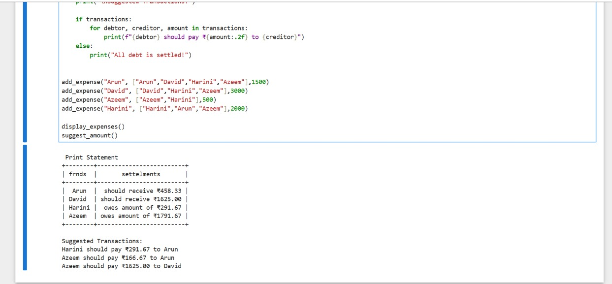
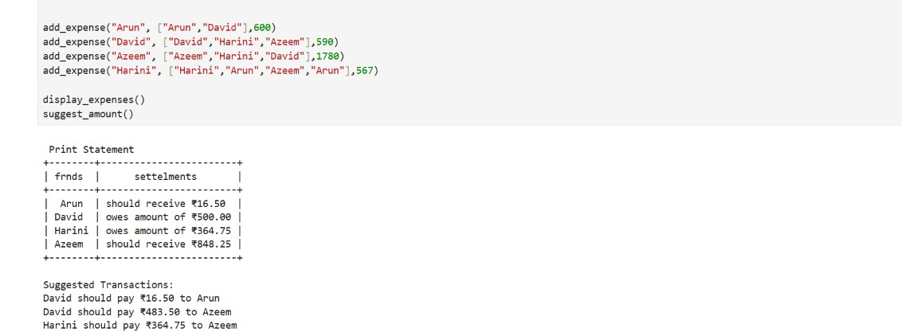

# GooglePay Expense Sharing System 💰

## 📌 Project Overview

The **GooglePay Expense Sharing System** is a Python-based project designed to help friends manage shared expenses and settle debts easily.

When multiple friends share expenses during trips, accommodation, food, or other activities, calculating individual expenses and determining who owes money can become difficult.

This project automates the process by calculating how much each person paid, how much each person owes, and suggesting the final payments required to settle all debts.

## 🎯 Problem Statement

Friends often share expenses, but different people pay for different activities. Manually calculating individual contributions and outstanding balances can be time-consuming and confusing.

The objective of this project is to develop a Python program that:

- Records expenses paid by different friends.
- Divides expenses equally among selected beneficiaries.
- Calculates the total amount paid by each person.
- Calculates how much each person owes.
- Identifies creditors and debtors.
- Suggests payments to settle outstanding balances.

## 🛠️ Technologies Used

- **Python** – Main programming language.
- **NumPy** – Used for creating and performing calculations on the expense matrix.
- **PrettyTable** – Used to display final settlements in a structured table.
- **Jupyter Notebook** – Used for writing and executing the Python code.

## ⚙️ Project Implementation

### 1. Importing Libraries

```python
import numpy as np
from prettytable import PrettyTable
```

NumPy is used for numerical calculations and expense matrix operations, while PrettyTable is used to display settlement details in a readable format.

### 2. Creating Friends List and Expense Matrix

```python
friends = ["Arun", "David", "Harini", "Azeem"]

expense_matrix = np.zeros((len(friends), len(friends)))
```

A list stores the names of four friends. A two-dimensional NumPy array is initialized with zeros to record shared expenses.

- Rows represent the person who paid.
- Columns represent the person whose expense was covered.

### 3. Adding Expenses – `add_expense()`

This function records expenses paid by each friend.

It:
- Identifies the payer using the list index.
- Divides the total expense equally among beneficiaries.
- Updates the expense matrix with each person's share.

### 4. Calculating Settlements – `calculate_settlements()`

This function calculates the financial balance of every friend.

It uses:

- `np.sum(expense_matrix, axis=1)` to calculate the total amount paid by each person.
- `np.sum(expense_matrix, axis=0)` to calculate the total amount owed by each person.

**Net Balance = Total Paid − Total Owed**

A positive balance indicates that the person should receive money, while a negative balance indicates that the person owes money.

### 5. Displaying Settlements – `display_settlements()`

This function uses PrettyTable to display the final settlement details.

It identifies whether each friend:
- Should receive money.
- Owes money.
- Has settled their balance.

### 6. Suggesting Payments – `suggest_payments()`

This function automatically generates payment suggestions.

It:
- Separates creditors and debtors based on their net balances.
- Matches debtors with creditors.
- Uses `min()` to determine the payment amount.
- Updates the remaining balances.
- Uses a `while` loop to continue matching until the settlement process is completed.

The final result displays who should pay whom and the corresponding amount.

## 🧮 Sample Expense Inputs

The project demonstrates two different expense scenarios using four friends: Arun, David, Harini and Azeem.

### Test Case 1 – Output 1

```python
add_expense("Arun", ["Arun","David","Harini","Azeem"], 1500)

add_expense("David", ["David","Harini","Azeem"], 3000)

add_expense("Azeem", ["Azeem","Harini"], 500)

add_expense("Harini", ["Harini","Arun","Azeem"], 2000)
```

### Test Case 2 – Output 2

```python
add_expense("Arun", ["Arun","David"], 600)

add_expense("David", ["David","Harini","Azeem"], 590)

add_expense("Azeem", ["Azeem","Harini","David"], 1780)

add_expense("Harini", ["Harini","Arun","Azeem","Arun"], 567)
```

## 📸 Project Output

### Output 1 – Final Settlements and Suggested Transactions

Displays the calculated balances and payment suggestions for the first expense scenario.



### Output 2 – Final Settlements and Suggested Transactions

Displays the calculated balances and payment suggestions for the second expense scenario.



## 📚 Python Concepts Used

- Lists and List Indexing
- Functions and Parameters
- NumPy Arrays
- Two-Dimensional Matrices
- For Loops and While Loops
- Conditional Statements (if, elif, else)
- List Comprehension
- Enumerate()
- Index()
- Append(), Pop() and Insert()
- Min() Function
- F-Strings and String Formatting

## 🚀 How to Run the Project

1. Clone or download this repository.
2. Open the project in Jupyter Notebook.
3. Install the required libraries:

```bash
pip install numpy prettytable
```

4. Set the friends list and initialize the expense matrix.
5. Execute the selected expense inputs.
6. Run `display_settlements()` to view the final balances.
7. Run `suggest_payments()` to view the suggested transactions.

**Note:** Run only one test case at a time in a fresh or reset notebook kernel, so previous expenses do not affect the next result.

## 🔮 Future Enhancements

- Add dynamic user input for friends and expenses.
- Support multiple expense categories.
- Add an interactive user interface.
- Store expense records using CSV or database integration.
- Develop a web-based expense-sharing application.

## 👨‍💻 Author

**Mohammed Bilaal Basha A.**

B.E. Mechatronics Engineering

SNS College of Technology, Coimbatore

---

⭐ If you find this project useful, feel free to explore the repository and provide feedback.
